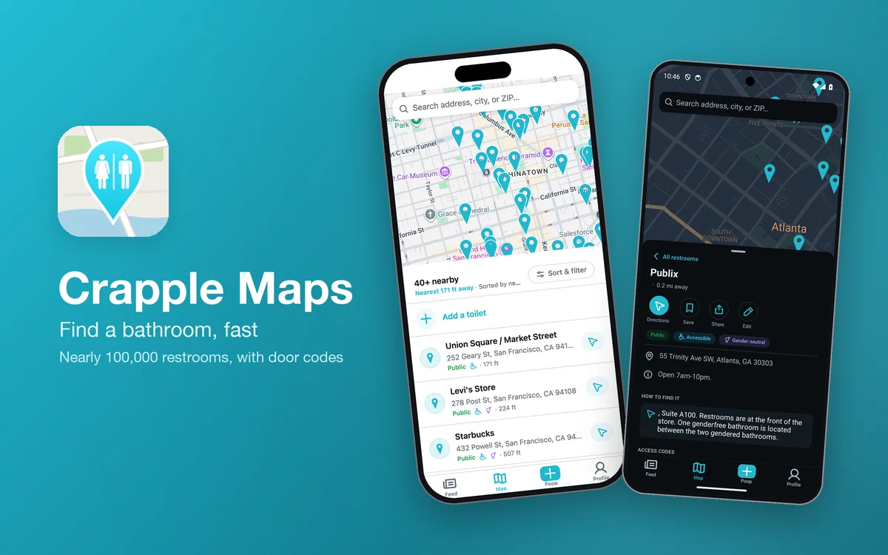
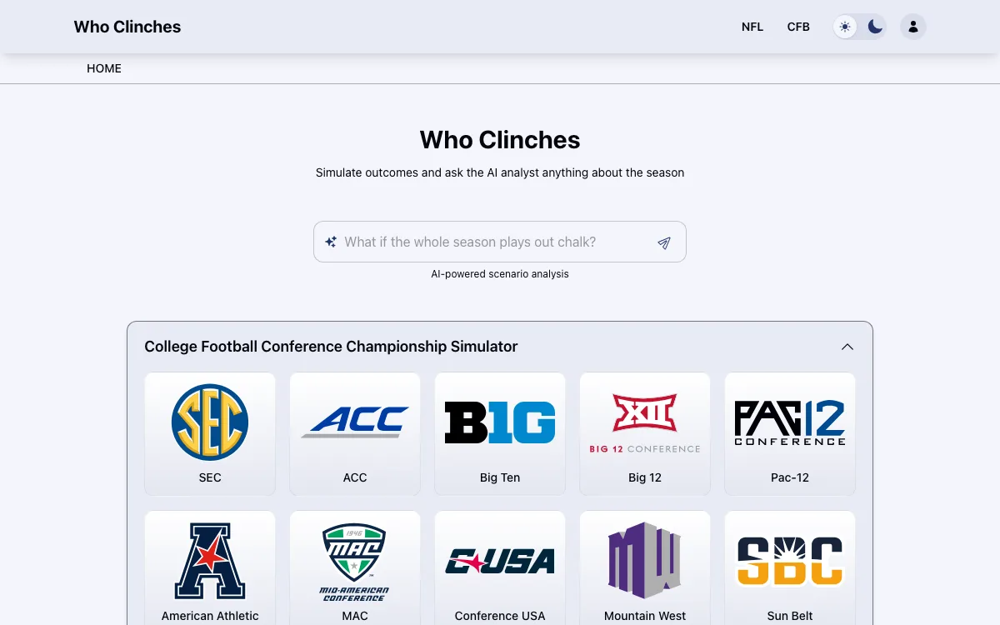
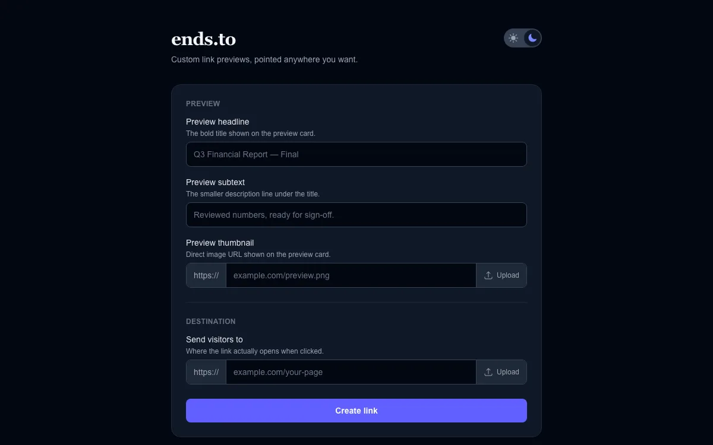
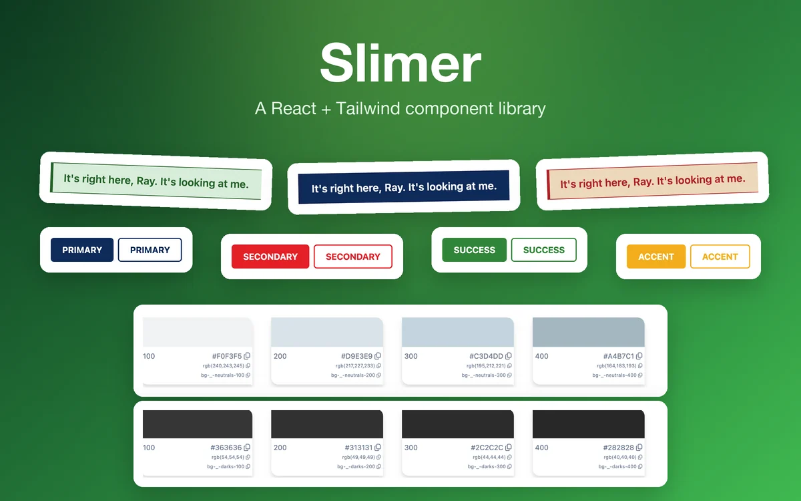
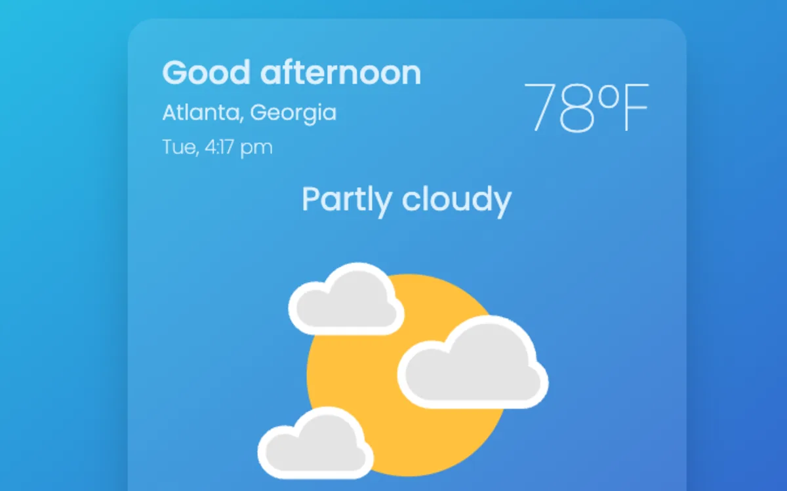
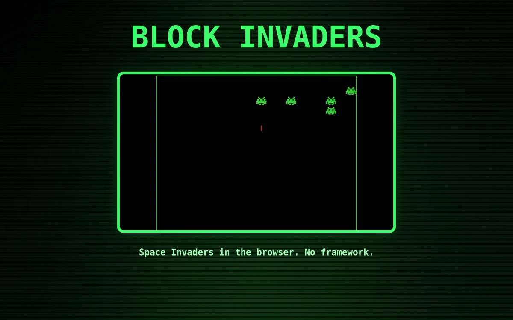

<!-- Generated from src/data by scripts/readme/generate.mjs. Edit the site data, not this file. -->

Hey there, I'm

# Austin Taylor

and I'm a Software Developer.

[![austinrt.io](https://img.shields.io/badge/austinrt.io-84A98C?style=flat-square&logo=data%3Aimage%2Fsvg%2Bxml%3Bbase64%2CPHN2ZyBzdHJva2U9ImN1cnJlbnRDb2xvciIgZmlsbD0iY3VycmVudENvbG9yIiBzdHJva2Utd2lkdGg9IjAiIHZpZXdCb3g9IjAgMCAxNiAxNiIgY29sb3I9IiNmZmYiIHN0eWxlPSJjb2xvcjojZmZmIiBoZWlnaHQ9IjFlbSIgd2lkdGg9IjFlbSIgeG1sbnM9Imh0dHA6Ly93d3cudzMub3JnLzIwMDAvc3ZnIj48cGF0aCBkPSJNMCA4YTggOCAwIDEgMSAxNiAwQTggOCAwIDAgMSAwIDhtNy41LTYuOTIzYy0uNjcuMjA0LTEuMzM1LjgyLTEuODg3IDEuODU1QTggOCAwIDAgMCA1LjE0NSA0SDcuNXpNNC4wOSA0YTkuMyA5LjMgMCAwIDEgLjY0LTEuNTM5IDcgNyAwIDAgMSAuNTk3LS45MzNBNy4wMyA3LjAzIDAgMCAwIDIuMjU1IDR6bS0uNTgyIDMuNWMuMDMtLjg3Ny4xMzgtMS43MTguMzEyLTIuNUgxLjY3NGE3IDcgMCAwIDAtLjY1NiAyLjV6TTQuODQ3IDVhMTIuNSAxMi41IDAgMCAwLS4zMzggMi41SDcuNVY1ek04LjUgNXYyLjVoMi45OWExMi41IDEyLjUgMCAwIDAtLjMzNy0yLjV6TTQuNTEgOC41YTEyLjUgMTIuNSAwIDAgMCAuMzM3IDIuNUg3LjVWOC41em0zLjk5IDBWMTFoMi42NTNjLjE4Ny0uNzY1LjMwNi0xLjYwOC4zMzgtMi41ek01LjE0NSAxMnEuMjA4LjU4LjQ2OCAxLjA2OGMuNTUyIDEuMDM1IDEuMjE4IDEuNjUgMS44ODcgMS44NTVWMTJ6bS4xODIgMi40NzJhNyA3IDAgMCAxLS41OTctLjkzM0E5LjMgOS4zIDAgMCAxIDQuMDkgMTJIMi4yNTVhNyA3IDAgMCAwIDMuMDcyIDIuNDcyTTMuODIgMTFhMTMuNyAxMy43IDAgMCAxLS4zMTItMi41aC0yLjQ5Yy4wNjIuODkuMjkxIDEuNzMzLjY1NiAyLjV6bTYuODUzIDMuNDcyQTcgNyAwIDAgMCAxMy43NDUgMTJIMTEuOTFhOS4zIDkuMyAwIDAgMS0uNjQgMS41MzkgNyA3IDAgMCAxLS41OTcuOTMzTTguNSAxMnYyLjkyM2MuNjctLjIwNCAxLjMzNS0uODIgMS44ODctMS44NTVxLjI2LS40ODcuNDY4LTEuMDY4em0zLjY4LTFoMi4xNDZjLjM2NS0uNzY3LjU5NC0xLjYxLjY1Ni0yLjVoLTIuNDlhMTMuNyAxMy43IDAgMCAxLS4zMTIgMi41bTIuODAyLTMuNWE3IDcgMCAwIDAtLjY1Ni0yLjVIMTIuMThjLjE3NC43ODIuMjgyIDEuNjIzLjMxMiAyLjV6TTExLjI3IDIuNDYxYy4yNDcuNDY0LjQ2Mi45OC42NCAxLjUzOWgxLjgzNWE3IDcgMCAwIDAtMy4wNzItMi40NzJjLjIxOC4yODQuNDE4LjU5OC41OTcuOTMzTTEwLjg1NSA0YTggOCAwIDAgMC0uNDY4LTEuMDY4QzkuODM1IDEuODk3IDkuMTcgMS4yODIgOC41IDEuMDc3VjR6Ij48L3BhdGg%2BPC9zdmc%2B)](https://austinrt.io) 

## A Little About Me

From the lens of a camera to the lines of code, I've always been driven by my passion for understanding what makes things tick. I bring a unique blend of technical and creative abilities to my work, whether writing code, working on vintage bikes, or shooting and developing my own film photography. This curiosity and a desire to connect led me to bridge gaps in the film industry and now in the tech world.

As a design-focused software engineer, I bring my technical skills, artistic eye, and creative problem-solving to the table in equal measure. My constant drive to evolve and my passion for mentoring others make me a valuable asset to any team.

After a successful tenure in the film industry, I am further cultivating my curiosity and creative spirit by crafting code and connecting communities.

## Projects

### [Crapple Maps](https://apps.apple.com/us/app/crapple-maps/id6795301489)

**Find the nearest public restroom, fast.**

Nearly 100,000 mapped restrooms with door codes, accessibility, and whether you have to buy something first. One Expo codebase ships the iOS app and the web app.

Built with Expo · React Native · TypeScript · Tailwind CSS · TanStack Query · Supabase · Postgres + PostGIS · Google Maps · Vercel

[![App Store](https://img.shields.io/badge/App%20Store-0D96F6?style=flat-square&logo=data%3Aimage%2Fsvg%2Bxml%3Bbase64%2CPHN2ZyBzdHJva2U9ImN1cnJlbnRDb2xvciIgZmlsbD0iY3VycmVudENvbG9yIiBzdHJva2Utd2lkdGg9IjAiIHZpZXdCb3g9IjAgMCA0NDggNTEyIiBjb2xvcj0iI2ZmZiIgc3R5bGU9ImNvbG9yOiNmZmYiIGhlaWdodD0iMWVtIiB3aWR0aD0iMWVtIiB4bWxucz0iaHR0cDovL3d3dy53My5vcmcvMjAwMC9zdmciPjxwYXRoIGQ9Ik00MDAgMzJINDhDMjEuNSAzMiAwIDUzLjUgMCA4MHYzNTJjMCAyNi41IDIxLjUgNDggNDggNDhoMzUyYzI2LjUgMCA0OC0yMS41IDQ4LTQ4VjgwYzAtMjYuNS0yMS41LTQ4LTQ4LTQ4ek0xMjcgMzg0LjVjLTUuNSA5LjYtMTcuOCAxMi44LTI3LjMgNy4zLTkuNi01LjUtMTIuOC0xNy44LTcuMy0yNy4zbDE0LjMtMjQuN2MxNi4xLTQuOSAyOS4zLTEuMSAzOS42IDExLjRMMTI3IDM4NC41em0xMzguOS01My45SDg0Yy0xMSAwLTIwLTktMjAtMjBzOS0yMCAyMC0yMGg1MWw2NS40LTExMy4yLTIwLjUtMzUuNGMtNS41LTkuNi0yLjItMjEuOCA3LjMtMjcuMyA5LjYtNS41IDIxLjgtMi4yIDI3LjMgNy4zbDguOSAxNS40IDguOS0xNS40YzUuNS05LjYgMTcuOC0xMi44IDI3LjMtNy4zIDkuNiA1LjUgMTIuOCAxNy44IDcuMyAyNy4zbC04NS44IDE0OC42aDYyLjFjMjAuMiAwIDMxLjUgMjMuNyAyMi43IDQwem05OC4xIDBoLTI5bDE5LjYgMzMuOWM1LjUgOS42IDIuMiAyMS44LTcuMyAyNy4zLTkuNiA1LjUtMjEuOCAyLjItMjcuMy03LjMtMzIuOS01Ni45LTU3LjUtOTkuNy03NC0xMjguMS0xNi43LTI5LTQuOC01OCA3LjEtNjcuOCAxMy4xIDIyLjcgMzIuNyA1Ni43IDU4LjkgMTAyaDUyYzExIDAgMjAgOSAyMCAyMCAwIDExLjEtOSAyMC0yMCAyMHoiPjwvcGF0aD48L3N2Zz4%3D)](https://apps.apple.com/us/app/crapple-maps/id6795301489) [![Web App](https://img.shields.io/badge/Web%20App-2F3E46?style=flat-square&logo=data%3Aimage%2Fsvg%2Bxml%3Bbase64%2CPHN2ZyBzdHJva2U9ImN1cnJlbnRDb2xvciIgZmlsbD0iY3VycmVudENvbG9yIiBzdHJva2Utd2lkdGg9IjAiIHZpZXdCb3g9IjAgMCAxNiAxNiIgY29sb3I9IiNmZmYiIHN0eWxlPSJjb2xvcjojZmZmIiBoZWlnaHQ9IjFlbSIgd2lkdGg9IjFlbSIgeG1sbnM9Imh0dHA6Ly93d3cudzMub3JnLzIwMDAvc3ZnIj48cGF0aCBkPSJNMCA4YTggOCAwIDEgMSAxNiAwQTggOCAwIDAgMSAwIDhtNy41LTYuOTIzYy0uNjcuMjA0LTEuMzM1LjgyLTEuODg3IDEuODU1QTggOCAwIDAgMCA1LjE0NSA0SDcuNXpNNC4wOSA0YTkuMyA5LjMgMCAwIDEgLjY0LTEuNTM5IDcgNyAwIDAgMSAuNTk3LS45MzNBNy4wMyA3LjAzIDAgMCAwIDIuMjU1IDR6bS0uNTgyIDMuNWMuMDMtLjg3Ny4xMzgtMS43MTguMzEyLTIuNUgxLjY3NGE3IDcgMCAwIDAtLjY1NiAyLjV6TTQuODQ3IDVhMTIuNSAxMi41IDAgMCAwLS4zMzggMi41SDcuNVY1ek04LjUgNXYyLjVoMi45OWExMi41IDEyLjUgMCAwIDAtLjMzNy0yLjV6TTQuNTEgOC41YTEyLjUgMTIuNSAwIDAgMCAuMzM3IDIuNUg3LjVWOC41em0zLjk5IDBWMTFoMi42NTNjLjE4Ny0uNzY1LjMwNi0xLjYwOC4zMzgtMi41ek01LjE0NSAxMnEuMjA4LjU4LjQ2OCAxLjA2OGMuNTUyIDEuMDM1IDEuMjE4IDEuNjUgMS44ODcgMS44NTVWMTJ6bS4xODIgMi40NzJhNyA3IDAgMCAxLS41OTctLjkzM0E5LjMgOS4zIDAgMCAxIDQuMDkgMTJIMi4yNTVhNyA3IDAgMCAwIDMuMDcyIDIuNDcyTTMuODIgMTFhMTMuNyAxMy43IDAgMCAxLS4zMTItMi41aC0yLjQ5Yy4wNjIuODkuMjkxIDEuNzMzLjY1NiAyLjV6bTYuODUzIDMuNDcyQTcgNyAwIDAgMCAxMy43NDUgMTJIMTEuOTFhOS4zIDkuMyAwIDAgMS0uNjQgMS41MzkgNyA3IDAgMCAxLS41OTcuOTMzTTguNSAxMnYyLjkyM2MuNjctLjIwNCAxLjMzNS0uODIgMS44ODctMS44NTVxLjI2LS40ODcuNDY4LTEuMDY4em0zLjY4LTFoMi4xNDZjLjM2NS0uNzY3LjU5NC0xLjYxLjY1Ni0yLjVoLTIuNDlhMTMuNyAxMy43IDAgMCAxLS4zMTIgMi41bTIuODAyLTMuNWE3IDcgMCAwIDAtLjY1Ni0yLjVIMTIuMThjLjE3NC43ODIuMjgyIDEuNjIzLjMxMiAyLjV6TTExLjI3IDIuNDYxYy4yNDcuNDY0LjQ2Mi45OC42NCAxLjUzOWgxLjgzNWE3IDcgMCAwIDAtMy4wNzItMi40NzJjLjIxOC4yODQuNDE4LjU5OC41OTcuOTMzTTEwLjg1NSA0YTggOCAwIDAgMC0uNDY4LTEuMDY4QzkuODM1IDEuODk3IDkuMTcgMS4yODIgOC41IDEuMDc3VjR6Ij48L3BhdGg%2BPC9zdmc%2B)](https://crapplemaps.com) [![GitHub](https://img.shields.io/badge/GitHub-444D56?style=flat-square&logo=data%3Aimage%2Fsvg%2Bxml%3Bbase64%2CPHN2ZyBzdHJva2U9ImN1cnJlbnRDb2xvciIgZmlsbD0iY3VycmVudENvbG9yIiBzdHJva2Utd2lkdGg9IjAiIHZpZXdCb3g9IjAgMCAxNiAxNiIgY29sb3I9IiNmZmYiIHN0eWxlPSJjb2xvcjojZmZmIiBoZWlnaHQ9IjFlbSIgd2lkdGg9IjFlbSIgeG1sbnM9Imh0dHA6Ly93d3cudzMub3JnLzIwMDAvc3ZnIj48cGF0aCBkPSJNOCAwQzMuNTggMCAwIDMuNTggMCA4YzAgMy41NCAyLjI5IDYuNTMgNS40NyA3LjU5LjQuMDcuNTUtLjE3LjU1LS4zOCAwLS4xOS0uMDEtLjgyLS4wMS0xLjQ5LTIuMDEuMzctMi41My0uNDktMi42OS0uOTQtLjA5LS4yMy0uNDgtLjk0LS44Mi0xLjEzLS4yOC0uMTUtLjY4LS41Mi0uMDEtLjUzLjYzLS4wMSAxLjA4LjU4IDEuMjMuODIuNzIgMS4yMSAxLjg3Ljg3IDIuMzMuNjYuMDctLjUyLjI4LS44Ny41MS0xLjA3LTEuNzgtLjItMy42NC0uODktMy42NC0zLjk1IDAtLjg3LjMxLTEuNTkuODItMi4xNS0uMDgtLjItLjM2LTEuMDIuMDgtMi4xMiAwIDAgLjY3LS4yMSAyLjIuODIuNjQtLjE4IDEuMzItLjI3IDItLjI3czEuMzYuMDkgMiAuMjdjMS41My0xLjA0IDIuMi0uODIgMi4yLS44Mi40NCAxLjEuMTYgMS45Mi4wOCAyLjEyLjUxLjU2LjgyIDEuMjcuODIgMi4xNSAwIDMuMDctMS44NyAzLjc1LTMuNjUgMy45NS4yOS4yNS41NC43My41NCAxLjQ4IDAgMS4wNy0uMDEgMS45My0uMDEgMi4yIDAgLjIxLjE1LjQ2LjU1LjM4QTguMDEgOC4wMSAwIDAgMCAxNiA4YzAtNC40Mi0zLjU4LTgtOC04Ij48L3BhdGg%2BPC9zdmc%2B)](https://github.com/austin-rt/crapple-maps)

### [Who Clinches](https://whoclinches.com)

**Simulate the rest of the season and see who clinches.**

Override any remaining game, college or NFL, and watch the standings recompute under the official tiebreaker rules, with live scores on game day and an AI analyst for what-if questions.

Built with Next.js · React · TypeScript · Redux Toolkit · Tailwind CSS · Postgres · Prisma · Redis · GraphQL · Voyage AI · Jest · Playwright · Vercel

[![Website](https://img.shields.io/badge/Website-2F3E46?style=flat-square&logo=data%3Aimage%2Fsvg%2Bxml%3Bbase64%2CPHN2ZyBzdHJva2U9ImN1cnJlbnRDb2xvciIgZmlsbD0iY3VycmVudENvbG9yIiBzdHJva2Utd2lkdGg9IjAiIHZpZXdCb3g9IjAgMCAxNiAxNiIgY29sb3I9IiNmZmYiIHN0eWxlPSJjb2xvcjojZmZmIiBoZWlnaHQ9IjFlbSIgd2lkdGg9IjFlbSIgeG1sbnM9Imh0dHA6Ly93d3cudzMub3JnLzIwMDAvc3ZnIj48cGF0aCBkPSJNMCA4YTggOCAwIDEgMSAxNiAwQTggOCAwIDAgMSAwIDhtNy41LTYuOTIzYy0uNjcuMjA0LTEuMzM1LjgyLTEuODg3IDEuODU1QTggOCAwIDAgMCA1LjE0NSA0SDcuNXpNNC4wOSA0YTkuMyA5LjMgMCAwIDEgLjY0LTEuNTM5IDcgNyAwIDAgMSAuNTk3LS45MzNBNy4wMyA3LjAzIDAgMCAwIDIuMjU1IDR6bS0uNTgyIDMuNWMuMDMtLjg3Ny4xMzgtMS43MTguMzEyLTIuNUgxLjY3NGE3IDcgMCAwIDAtLjY1NiAyLjV6TTQuODQ3IDVhMTIuNSAxMi41IDAgMCAwLS4zMzggMi41SDcuNVY1ek04LjUgNXYyLjVoMi45OWExMi41IDEyLjUgMCAwIDAtLjMzNy0yLjV6TTQuNTEgOC41YTEyLjUgMTIuNSAwIDAgMCAuMzM3IDIuNUg3LjVWOC41em0zLjk5IDBWMTFoMi42NTNjLjE4Ny0uNzY1LjMwNi0xLjYwOC4zMzgtMi41ek01LjE0NSAxMnEuMjA4LjU4LjQ2OCAxLjA2OGMuNTUyIDEuMDM1IDEuMjE4IDEuNjUgMS44ODcgMS44NTVWMTJ6bS4xODIgMi40NzJhNyA3IDAgMCAxLS41OTctLjkzM0E5LjMgOS4zIDAgMCAxIDQuMDkgMTJIMi4yNTVhNyA3IDAgMCAwIDMuMDcyIDIuNDcyTTMuODIgMTFhMTMuNyAxMy43IDAgMCAxLS4zMTItMi41aC0yLjQ5Yy4wNjIuODkuMjkxIDEuNzMzLjY1NiAyLjV6bTYuODUzIDMuNDcyQTcgNyAwIDAgMCAxMy43NDUgMTJIMTEuOTFhOS4zIDkuMyAwIDAgMS0uNjQgMS41MzkgNyA3IDAgMCAxLS41OTcuOTMzTTguNSAxMnYyLjkyM2MuNjctLjIwNCAxLjMzNS0uODIgMS44ODctMS44NTVxLjI2LS40ODcuNDY4LTEuMDY4em0zLjY4LTFoMi4xNDZjLjM2NS0uNzY3LjU5NC0xLjYxLjY1Ni0yLjVoLTIuNDlhMTMuNyAxMy43IDAgMCAxLS4zMTIgMi41bTIuODAyLTMuNWE3IDcgMCAwIDAtLjY1Ni0yLjVIMTIuMThjLjE3NC43ODIuMjgyIDEuNjIzLjMxMiAyLjV6TTExLjI3IDIuNDYxYy4yNDcuNDY0LjQ2Mi45OC42NCAxLjUzOWgxLjgzNWE3IDcgMCAwIDAtMy4wNzItMi40NzJjLjIxOC4yODQuNDE4LjU5OC41OTcuOTMzTTEwLjg1NSA0YTggOCAwIDAgMC0uNDY4LTEuMDY4QzkuODM1IDEuODk3IDkuMTcgMS4yODIgOC41IDEuMDc3VjR6Ij48L3BhdGg%2BPC9zdmc%2B)](https://whoclinches.com) [![GitHub](https://img.shields.io/badge/GitHub-444D56?style=flat-square&logo=data%3Aimage%2Fsvg%2Bxml%3Bbase64%2CPHN2ZyBzdHJva2U9ImN1cnJlbnRDb2xvciIgZmlsbD0iY3VycmVudENvbG9yIiBzdHJva2Utd2lkdGg9IjAiIHZpZXdCb3g9IjAgMCAxNiAxNiIgY29sb3I9IiNmZmYiIHN0eWxlPSJjb2xvcjojZmZmIiBoZWlnaHQ9IjFlbSIgd2lkdGg9IjFlbSIgeG1sbnM9Imh0dHA6Ly93d3cudzMub3JnLzIwMDAvc3ZnIj48cGF0aCBkPSJNOCAwQzMuNTggMCAwIDMuNTggMCA4YzAgMy41NCAyLjI5IDYuNTMgNS40NyA3LjU5LjQuMDcuNTUtLjE3LjU1LS4zOCAwLS4xOS0uMDEtLjgyLS4wMS0xLjQ5LTIuMDEuMzctMi41My0uNDktMi42OS0uOTQtLjA5LS4yMy0uNDgtLjk0LS44Mi0xLjEzLS4yOC0uMTUtLjY4LS41Mi0uMDEtLjUzLjYzLS4wMSAxLjA4LjU4IDEuMjMuODIuNzIgMS4yMSAxLjg3Ljg3IDIuMzMuNjYuMDctLjUyLjI4LS44Ny41MS0xLjA3LTEuNzgtLjItMy42NC0uODktMy42NC0zLjk1IDAtLjg3LjMxLTEuNTkuODItMi4xNS0uMDgtLjItLjM2LTEuMDIuMDgtMi4xMiAwIDAgLjY3LS4yMSAyLjIuODIuNjQtLjE4IDEuMzItLjI3IDItLjI3czEuMzYuMDkgMiAuMjdjMS41My0xLjA0IDIuMi0uODIgMi4yLS44Mi40NCAxLjEuMTYgMS45Mi4wOCAyLjEyLjUxLjU2LjgyIDEuMjcuODIgMi4xNSAwIDMuMDctMS44NyAzLjc1LTMuNjUgMy45NS4yOS4yNS41NC43My41NCAxLjQ4IDAgMS4wNy0uMDEgMS45My0uMDEgMi4yIDAgLjIxLjE1LjQ2LjU1LjM4QTguMDEgOC4wMSAwIDAgMCAxNiA4YzAtNC40Mi0zLjU4LTgtOC04Ij48L3BhdGg%2BPC9zdmc%2B)](https://github.com/austin-rt/who-clinches)

### [ends.to](https://ends.to)

**Short links with a fully custom preview.**

Choose the title, description and thumbnail a link shows when it's shared, then point it anywhere. The preview is encoded in the URL, so there's no database.

Built with Next.js · React · TypeScript · Tailwind CSS · Vercel

[![Website](https://img.shields.io/badge/Website-2F3E46?style=flat-square&logo=data%3Aimage%2Fsvg%2Bxml%3Bbase64%2CPHN2ZyBzdHJva2U9ImN1cnJlbnRDb2xvciIgZmlsbD0iY3VycmVudENvbG9yIiBzdHJva2Utd2lkdGg9IjAiIHZpZXdCb3g9IjAgMCAxNiAxNiIgY29sb3I9IiNmZmYiIHN0eWxlPSJjb2xvcjojZmZmIiBoZWlnaHQ9IjFlbSIgd2lkdGg9IjFlbSIgeG1sbnM9Imh0dHA6Ly93d3cudzMub3JnLzIwMDAvc3ZnIj48cGF0aCBkPSJNMCA4YTggOCAwIDEgMSAxNiAwQTggOCAwIDAgMSAwIDhtNy41LTYuOTIzYy0uNjcuMjA0LTEuMzM1LjgyLTEuODg3IDEuODU1QTggOCAwIDAgMCA1LjE0NSA0SDcuNXpNNC4wOSA0YTkuMyA5LjMgMCAwIDEgLjY0LTEuNTM5IDcgNyAwIDAgMSAuNTk3LS45MzNBNy4wMyA3LjAzIDAgMCAwIDIuMjU1IDR6bS0uNTgyIDMuNWMuMDMtLjg3Ny4xMzgtMS43MTguMzEyLTIuNUgxLjY3NGE3IDcgMCAwIDAtLjY1NiAyLjV6TTQuODQ3IDVhMTIuNSAxMi41IDAgMCAwLS4zMzggMi41SDcuNVY1ek04LjUgNXYyLjVoMi45OWExMi41IDEyLjUgMCAwIDAtLjMzNy0yLjV6TTQuNTEgOC41YTEyLjUgMTIuNSAwIDAgMCAuMzM3IDIuNUg3LjVWOC41em0zLjk5IDBWMTFoMi42NTNjLjE4Ny0uNzY1LjMwNi0xLjYwOC4zMzgtMi41ek01LjE0NSAxMnEuMjA4LjU4LjQ2OCAxLjA2OGMuNTUyIDEuMDM1IDEuMjE4IDEuNjUgMS44ODcgMS44NTVWMTJ6bS4xODIgMi40NzJhNyA3IDAgMCAxLS41OTctLjkzM0E5LjMgOS4zIDAgMCAxIDQuMDkgMTJIMi4yNTVhNyA3IDAgMCAwIDMuMDcyIDIuNDcyTTMuODIgMTFhMTMuNyAxMy43IDAgMCAxLS4zMTItMi41aC0yLjQ5Yy4wNjIuODkuMjkxIDEuNzMzLjY1NiAyLjV6bTYuODUzIDMuNDcyQTcgNyAwIDAgMCAxMy43NDUgMTJIMTEuOTFhOS4zIDkuMyAwIDAgMS0uNjQgMS41MzkgNyA3IDAgMCAxLS41OTcuOTMzTTguNSAxMnYyLjkyM2MuNjctLjIwNCAxLjMzNS0uODIgMS44ODctMS44NTVxLjI2LS40ODcuNDY4LTEuMDY4em0zLjY4LTFoMi4xNDZjLjM2NS0uNzY3LjU5NC0xLjYxLjY1Ni0yLjVoLTIuNDlhMTMuNyAxMy43IDAgMCAxLS4zMTIgMi41bTIuODAyLTMuNWE3IDcgMCAwIDAtLjY1Ni0yLjVIMTIuMThjLjE3NC43ODIuMjgyIDEuNjIzLjMxMiAyLjV6TTExLjI3IDIuNDYxYy4yNDcuNDY0LjQ2Mi45OC42NCAxLjUzOWgxLjgzNWE3IDcgMCAwIDAtMy4wNzItMi40NzJjLjIxOC4yODQuNDE4LjU5OC41OTcuOTMzTTEwLjg1NSA0YTggOCAwIDAgMC0uNDY4LTEuMDY4QzkuODM1IDEuODk3IDkuMTcgMS4yODIgOC41IDEuMDc3VjR6Ij48L3BhdGg%2BPC9zdmc%2B)](https://ends.to) [![GitHub](https://img.shields.io/badge/GitHub-444D56?style=flat-square&logo=data%3Aimage%2Fsvg%2Bxml%3Bbase64%2CPHN2ZyBzdHJva2U9ImN1cnJlbnRDb2xvciIgZmlsbD0iY3VycmVudENvbG9yIiBzdHJva2Utd2lkdGg9IjAiIHZpZXdCb3g9IjAgMCAxNiAxNiIgY29sb3I9IiNmZmYiIHN0eWxlPSJjb2xvcjojZmZmIiBoZWlnaHQ9IjFlbSIgd2lkdGg9IjFlbSIgeG1sbnM9Imh0dHA6Ly93d3cudzMub3JnLzIwMDAvc3ZnIj48cGF0aCBkPSJNOCAwQzMuNTggMCAwIDMuNTggMCA4YzAgMy41NCAyLjI5IDYuNTMgNS40NyA3LjU5LjQuMDcuNTUtLjE3LjU1LS4zOCAwLS4xOS0uMDEtLjgyLS4wMS0xLjQ5LTIuMDEuMzctMi41My0uNDktMi42OS0uOTQtLjA5LS4yMy0uNDgtLjk0LS44Mi0xLjEzLS4yOC0uMTUtLjY4LS41Mi0uMDEtLjUzLjYzLS4wMSAxLjA4LjU4IDEuMjMuODIuNzIgMS4yMSAxLjg3Ljg3IDIuMzMuNjYuMDctLjUyLjI4LS44Ny41MS0xLjA3LTEuNzgtLjItMy42NC0uODktMy42NC0zLjk1IDAtLjg3LjMxLTEuNTkuODItMi4xNS0uMDgtLjItLjM2LTEuMDIuMDgtMi4xMiAwIDAgLjY3LS4yMSAyLjIuODIuNjQtLjE4IDEuMzItLjI3IDItLjI3czEuMzYuMDkgMiAuMjdjMS41My0xLjA0IDIuMi0uODIgMi4yLS44Mi40NCAxLjEuMTYgMS45Mi4wOCAyLjEyLjUxLjU2LjgyIDEuMjcuODIgMi4xNSAwIDMuMDctMS44NyAzLjc1LTMuNjUgMy45NS4yOS4yNS41NC43My41NCAxLjQ4IDAgMS4wNy0uMDEgMS45My0uMDEgMi4yIDAgLjIxLjE1LjQ2LjU1LjM4QTguMDEgOC4wMSAwIDAgMCAxNiA4YzAtNC40Mi0zLjU4LTgtOC04Ij48L3BhdGg%2BPC9zdmc%2B)](https://github.com/austin-rt/prank-link)

### [Carousel](https://github.com/austin-rt/picture-frame)

**A self-hosted digital picture frame.**

Rooted, stripped of its stock software, and rebuilt around Termux: rclone pulls photos and videos from cloud storage, ffmpeg resizes them, and a small kiosk APK plays the slideshow. Deploys over Tailscale from CI.

Built with Bash · JavaScript · Java · Android · Rust · rclone · FFmpeg

[![GitHub](https://img.shields.io/badge/GitHub-444D56?style=flat-square&logo=data%3Aimage%2Fsvg%2Bxml%3Bbase64%2CPHN2ZyBzdHJva2U9ImN1cnJlbnRDb2xvciIgZmlsbD0iY3VycmVudENvbG9yIiBzdHJva2Utd2lkdGg9IjAiIHZpZXdCb3g9IjAgMCAxNiAxNiIgY29sb3I9IiNmZmYiIHN0eWxlPSJjb2xvcjojZmZmIiBoZWlnaHQ9IjFlbSIgd2lkdGg9IjFlbSIgeG1sbnM9Imh0dHA6Ly93d3cudzMub3JnLzIwMDAvc3ZnIj48cGF0aCBkPSJNOCAwQzMuNTggMCAwIDMuNTggMCA4YzAgMy41NCAyLjI5IDYuNTMgNS40NyA3LjU5LjQuMDcuNTUtLjE3LjU1LS4zOCAwLS4xOS0uMDEtLjgyLS4wMS0xLjQ5LTIuMDEuMzctMi41My0uNDktMi42OS0uOTQtLjA5LS4yMy0uNDgtLjk0LS44Mi0xLjEzLS4yOC0uMTUtLjY4LS41Mi0uMDEtLjUzLjYzLS4wMSAxLjA4LjU4IDEuMjMuODIuNzIgMS4yMSAxLjg3Ljg3IDIuMzMuNjYuMDctLjUyLjI4LS44Ny41MS0xLjA3LTEuNzgtLjItMy42NC0uODktMy42NC0zLjk1IDAtLjg3LjMxLTEuNTkuODItMi4xNS0uMDgtLjItLjM2LTEuMDIuMDgtMi4xMiAwIDAgLjY3LS4yMSAyLjIuODIuNjQtLjE4IDEuMzItLjI3IDItLjI3czEuMzYuMDkgMiAuMjdjMS41My0xLjA0IDIuMi0uODIgMi4yLS44Mi40NCAxLjEuMTYgMS45Mi4wOCAyLjEyLjUxLjU2LjgyIDEuMjcuODIgMi4xNSAwIDMuMDctMS44NyAzLjc1LTMuNjUgMy45NS4yOS4yNS41NC43My41NCAxLjQ4IDAgMS4wNy0uMDEgMS45My0uMDEgMi4yIDAgLjIxLjE1LjQ2LjU1LjM4QTguMDEgOC4wMSAwIDAgMCAxNiA4YzAtNC40Mi0zLjU4LTgtOC04Ij48L3BhdGg%2BPC9zdmc%2B)](https://github.com/austin-rt/picture-frame)

### [Stay Puft Forms](https://staypuftforms.netlify.app/)

**Typesafe, accessible React form components.**

A form component library built for an e-commerce app: schema-driven validation, keyboard and screen-reader friendly, documented in Storybook.

Built with React · TypeScript · React Hook Form · Zod · Tailwind CSS · Storybook

[![Storybook](https://img.shields.io/badge/Storybook-FF4785?style=flat-square&logo=data%3Aimage%2Fsvg%2Bxml%3Bbase64%2CPHN2ZyBzdHJva2U9ImN1cnJlbnRDb2xvciIgZmlsbD0iY3VycmVudENvbG9yIiBzdHJva2Utd2lkdGg9IjAiIHJvbGU9ImltZyIgdmlld0JveD0iMCAwIDI0IDI0IiBjb2xvcj0iI2ZmZiIgc3R5bGU9ImNvbG9yOiNmZmYiIGhlaWdodD0iMWVtIiB3aWR0aD0iMWVtIiB4bWxucz0iaHR0cDovL3d3dy53My5vcmcvMjAwMC9zdmciPjxwYXRoIGQ9Ik0xNi43MS4yNDNsLS4xMiAyLjcxYS4xOC4xOCAwIDAwLjI5LjE1bDEuMDYtLjguOS43YS4xOC4xOCAwIDAwLjI4LS4xNGwtLjEtMi43NiAxLjMzLS4xYTEuMiAxLjIgMCAwMTEuMjc5IDEuMnYyMS41OTZhMS4yIDEuMiAwIDAxLTEuMjYgMS4ybC0xNi4wOTYtLjcyYTEuMiAxLjIgMCAwMS0xLjE1LTEuMTZsLS43NS0xOS43OTdhMS4yIDEuMiAwIDAxMS4xMy0xLjI3TDE2LjcuMjIyek0xMy42NCA5LjNjMCAuNDcgMy4xNi4yNCAzLjU5LS4wOCAwLTMuMi0xLjcyLTQuODktNC44NTktNC44OS0zLjE1IDAtNC44OTkgMS43Mi00Ljg5OSA0LjI5IDAgNC40NSA1Ljk5OSA0LjUzIDUuOTk5IDYuOTU5IDAgLjctLjMyIDEuMS0xLjA1IDEuMS0uOTYgMC0xLjM1LS40OS0xLjMtMi4xNiAwLS4zNi0zLjY0OS0uNDgtMy43NjkgMC0uMjcgNC4wMyAyLjIzIDUuMiA1LjA5OSA1LjIgMi43OSAwIDQuOTY5LTEuNDkgNC45NjktNC4xOCAwLTQuNzctNi4wOTktNC42NC02LjA5OS02Ljk5OSAwLS45Ny43Mi0xLjEgMS4xMy0xLjEuNDUgMCAxLjI1LjA3IDEuMTkgMS44N3oiPjwvcGF0aD48L3N2Zz4%3D)](https://staypuftforms.netlify.app/) [![GitHub](https://img.shields.io/badge/GitHub-444D56?style=flat-square&logo=data%3Aimage%2Fsvg%2Bxml%3Bbase64%2CPHN2ZyBzdHJva2U9ImN1cnJlbnRDb2xvciIgZmlsbD0iY3VycmVudENvbG9yIiBzdHJva2Utd2lkdGg9IjAiIHZpZXdCb3g9IjAgMCAxNiAxNiIgY29sb3I9IiNmZmYiIHN0eWxlPSJjb2xvcjojZmZmIiBoZWlnaHQ9IjFlbSIgd2lkdGg9IjFlbSIgeG1sbnM9Imh0dHA6Ly93d3cudzMub3JnLzIwMDAvc3ZnIj48cGF0aCBkPSJNOCAwQzMuNTggMCAwIDMuNTggMCA4YzAgMy41NCAyLjI5IDYuNTMgNS40NyA3LjU5LjQuMDcuNTUtLjE3LjU1LS4zOCAwLS4xOS0uMDEtLjgyLS4wMS0xLjQ5LTIuMDEuMzctMi41My0uNDktMi42OS0uOTQtLjA5LS4yMy0uNDgtLjk0LS44Mi0xLjEzLS4yOC0uMTUtLjY4LS41Mi0uMDEtLjUzLjYzLS4wMSAxLjA4LjU4IDEuMjMuODIuNzIgMS4yMSAxLjg3Ljg3IDIuMzMuNjYuMDctLjUyLjI4LS44Ny41MS0xLjA3LTEuNzgtLjItMy42NC0uODktMy42NC0zLjk1IDAtLjg3LjMxLTEuNTkuODItMi4xNS0uMDgtLjItLjM2LTEuMDIuMDgtMi4xMiAwIDAgLjY3LS4yMSAyLjIuODIuNjQtLjE4IDEuMzItLjI3IDItLjI3czEuMzYuMDkgMiAuMjdjMS41My0xLjA0IDIuMi0uODIgMi4yLS44Mi40NCAxLjEuMTYgMS45Mi4wOCAyLjEyLjUxLjU2LjgyIDEuMjcuODIgMi4xNSAwIDMuMDctMS44NyAzLjc1LTMuNjUgMy45NS4yOS4yNS41NC43My41NCAxLjQ4IDAgMS4wNy0uMDEgMS45My0uMDEgMi4yIDAgLjIxLjE1LjQ2LjU1LjM4QTguMDEgOC4wMSAwIDAgMCAxNiA4YzAtNC40Mi0zLjU4LTgtOC04Ij48L3BhdGg%2BPC9zdmc%2B)](https://github.com/austin-rt/stay-puft)

### [Slimer Component Library](https://slimer.netlify.app/)

**Tailwind and React building blocks with Storybook docs.**

The shared component library behind Stay Puft Forms and the apps that use it: tokens, primitives and composed components, all documented in Storybook.

Built with React · TypeScript · Tailwind CSS · Storybook

[![Storybook](https://img.shields.io/badge/Storybook-FF4785?style=flat-square&logo=data%3Aimage%2Fsvg%2Bxml%3Bbase64%2CPHN2ZyBzdHJva2U9ImN1cnJlbnRDb2xvciIgZmlsbD0iY3VycmVudENvbG9yIiBzdHJva2Utd2lkdGg9IjAiIHJvbGU9ImltZyIgdmlld0JveD0iMCAwIDI0IDI0IiBjb2xvcj0iI2ZmZiIgc3R5bGU9ImNvbG9yOiNmZmYiIGhlaWdodD0iMWVtIiB3aWR0aD0iMWVtIiB4bWxucz0iaHR0cDovL3d3dy53My5vcmcvMjAwMC9zdmciPjxwYXRoIGQ9Ik0xNi43MS4yNDNsLS4xMiAyLjcxYS4xOC4xOCAwIDAwLjI5LjE1bDEuMDYtLjguOS43YS4xOC4xOCAwIDAwLjI4LS4xNGwtLjEtMi43NiAxLjMzLS4xYTEuMiAxLjIgMCAwMTEuMjc5IDEuMnYyMS41OTZhMS4yIDEuMiAwIDAxLTEuMjYgMS4ybC0xNi4wOTYtLjcyYTEuMiAxLjIgMCAwMS0xLjE1LTEuMTZsLS43NS0xOS43OTdhMS4yIDEuMiAwIDAxMS4xMy0xLjI3TDE2LjcuMjIyek0xMy42NCA5LjNjMCAuNDcgMy4xNi4yNCAzLjU5LS4wOCAwLTMuMi0xLjcyLTQuODktNC44NTktNC44OS0zLjE1IDAtNC44OTkgMS43Mi00Ljg5OSA0LjI5IDAgNC40NSA1Ljk5OSA0LjUzIDUuOTk5IDYuOTU5IDAgLjctLjMyIDEuMS0xLjA1IDEuMS0uOTYgMC0xLjM1LS40OS0xLjMtMi4xNiAwLS4zNi0zLjY0OS0uNDgtMy43NjkgMC0uMjcgNC4wMyAyLjIzIDUuMiA1LjA5OSA1LjIgMi43OSAwIDQuOTY5LTEuNDkgNC45NjktNC4xOCAwLTQuNzctNi4wOTktNC42NC02LjA5OS02Ljk5OSAwLS45Ny43Mi0xLjEgMS4xMy0xLjEuNDUgMCAxLjI1LjA3IDEuMTkgMS44N3oiPjwvcGF0aD48L3N2Zz4%3D)](https://slimer.netlify.app/)

### [Blue Skies](https://blue-skies-weather.netlify.app/)

**Current conditions and a three-day forecast, wherever you are.**

A weather app case study: geolocated current conditions, highs and lows for the next three days, and a deliberately calm interface.

Built with React · TypeScript · Redux Toolkit · Tailwind CSS · Netlify

[![Website](https://img.shields.io/badge/Website-2F3E46?style=flat-square&logo=data%3Aimage%2Fsvg%2Bxml%3Bbase64%2CPHN2ZyBzdHJva2U9ImN1cnJlbnRDb2xvciIgZmlsbD0iY3VycmVudENvbG9yIiBzdHJva2Utd2lkdGg9IjAiIHZpZXdCb3g9IjAgMCAxNiAxNiIgY29sb3I9IiNmZmYiIHN0eWxlPSJjb2xvcjojZmZmIiBoZWlnaHQ9IjFlbSIgd2lkdGg9IjFlbSIgeG1sbnM9Imh0dHA6Ly93d3cudzMub3JnLzIwMDAvc3ZnIj48cGF0aCBkPSJNMCA4YTggOCAwIDEgMSAxNiAwQTggOCAwIDAgMSAwIDhtNy41LTYuOTIzYy0uNjcuMjA0LTEuMzM1LjgyLTEuODg3IDEuODU1QTggOCAwIDAgMCA1LjE0NSA0SDcuNXpNNC4wOSA0YTkuMyA5LjMgMCAwIDEgLjY0LTEuNTM5IDcgNyAwIDAgMSAuNTk3LS45MzNBNy4wMyA3LjAzIDAgMCAwIDIuMjU1IDR6bS0uNTgyIDMuNWMuMDMtLjg3Ny4xMzgtMS43MTguMzEyLTIuNUgxLjY3NGE3IDcgMCAwIDAtLjY1NiAyLjV6TTQuODQ3IDVhMTIuNSAxMi41IDAgMCAwLS4zMzggMi41SDcuNVY1ek04LjUgNXYyLjVoMi45OWExMi41IDEyLjUgMCAwIDAtLjMzNy0yLjV6TTQuNTEgOC41YTEyLjUgMTIuNSAwIDAgMCAuMzM3IDIuNUg3LjVWOC41em0zLjk5IDBWMTFoMi42NTNjLjE4Ny0uNzY1LjMwNi0xLjYwOC4zMzgtMi41ek01LjE0NSAxMnEuMjA4LjU4LjQ2OCAxLjA2OGMuNTUyIDEuMDM1IDEuMjE4IDEuNjUgMS44ODcgMS44NTVWMTJ6bS4xODIgMi40NzJhNyA3IDAgMCAxLS41OTctLjkzM0E5LjMgOS4zIDAgMCAxIDQuMDkgMTJIMi4yNTVhNyA3IDAgMCAwIDMuMDcyIDIuNDcyTTMuODIgMTFhMTMuNyAxMy43IDAgMCAxLS4zMTItMi41aC0yLjQ5Yy4wNjIuODkuMjkxIDEuNzMzLjY1NiAyLjV6bTYuODUzIDMuNDcyQTcgNyAwIDAgMCAxMy43NDUgMTJIMTEuOTFhOS4zIDkuMyAwIDAgMS0uNjQgMS41MzkgNyA3IDAgMCAxLS41OTcuOTMzTTguNSAxMnYyLjkyM2MuNjctLjIwNCAxLjMzNS0uODIgMS44ODctMS44NTVxLjI2LS40ODcuNDY4LTEuMDY4em0zLjY4LTFoMi4xNDZjLjM2NS0uNzY3LjU5NC0xLjYxLjY1Ni0yLjVoLTIuNDlhMTMuNyAxMy43IDAgMCAxLS4zMTIgMi41bTIuODAyLTMuNWE3IDcgMCAwIDAtLjY1Ni0yLjVIMTIuMThjLjE3NC43ODIuMjgyIDEuNjIzLjMxMiAyLjV6TTExLjI3IDIuNDYxYy4yNDcuNDY0LjQ2Mi45OC42NCAxLjUzOWgxLjgzNWE3IDcgMCAwIDAtMy4wNzItMi40NzJjLjIxOC4yODQuNDE4LjU5OC41OTcuOTMzTTEwLjg1NSA0YTggOCAwIDAgMC0uNDY4LTEuMDY4QzkuODM1IDEuODk3IDkuMTcgMS4yODIgOC41IDEuMDc3VjR6Ij48L3BhdGg%2BPC9zdmc%2B)](https://blue-skies-weather.netlify.app/) [![GitHub](https://img.shields.io/badge/GitHub-444D56?style=flat-square&logo=data%3Aimage%2Fsvg%2Bxml%3Bbase64%2CPHN2ZyBzdHJva2U9ImN1cnJlbnRDb2xvciIgZmlsbD0iY3VycmVudENvbG9yIiBzdHJva2Utd2lkdGg9IjAiIHZpZXdCb3g9IjAgMCAxNiAxNiIgY29sb3I9IiNmZmYiIHN0eWxlPSJjb2xvcjojZmZmIiBoZWlnaHQ9IjFlbSIgd2lkdGg9IjFlbSIgeG1sbnM9Imh0dHA6Ly93d3cudzMub3JnLzIwMDAvc3ZnIj48cGF0aCBkPSJNOCAwQzMuNTggMCAwIDMuNTggMCA4YzAgMy41NCAyLjI5IDYuNTMgNS40NyA3LjU5LjQuMDcuNTUtLjE3LjU1LS4zOCAwLS4xOS0uMDEtLjgyLS4wMS0xLjQ5LTIuMDEuMzctMi41My0uNDktMi42OS0uOTQtLjA5LS4yMy0uNDgtLjk0LS44Mi0xLjEzLS4yOC0uMTUtLjY4LS41Mi0uMDEtLjUzLjYzLS4wMSAxLjA4LjU4IDEuMjMuODIuNzIgMS4yMSAxLjg3Ljg3IDIuMzMuNjYuMDctLjUyLjI4LS44Ny41MS0xLjA3LTEuNzgtLjItMy42NC0uODktMy42NC0zLjk1IDAtLjg3LjMxLTEuNTkuODItMi4xNS0uMDgtLjItLjM2LTEuMDIuMDgtMi4xMiAwIDAgLjY3LS4yMSAyLjIuODIuNjQtLjE4IDEuMzItLjI3IDItLjI3czEuMzYuMDkgMiAuMjdjMS41My0xLjA0IDIuMi0uODIgMi4yLS44Mi40NCAxLjEuMTYgMS45Mi4wOCAyLjEyLjUxLjU2LjgyIDEuMjcuODIgMi4xNSAwIDMuMDctMS44NyAzLjc1LTMuNjUgMy45NS4yOS4yNS41NC43My41NCAxLjQ4IDAgMS4wNy0uMDEgMS45My0uMDEgMi4yIDAgLjIxLjE1LjQ2LjU1LjM4QTguMDEgOC4wMSAwIDAgMCAxNiA4YzAtNC40Mi0zLjU4LTgtOC04Ij48L3BhdGg%2BPC9zdmc%2B)](https://github.com/austin-rt/weather-app-case-study)

### [Block Invaders](https://austin-rt.github.io/blockinvaders)

**Multi-level browser Space Invaders in vanilla TypeScript.**

Move, shoot, survive. The invaders descend faster with every level. No framework, no canvas library, just the DOM.

Built with HTML · CSS · TypeScript · GitHub Pages

[![Website](https://img.shields.io/badge/Website-2F3E46?style=flat-square&logo=data%3Aimage%2Fsvg%2Bxml%3Bbase64%2CPHN2ZyBzdHJva2U9ImN1cnJlbnRDb2xvciIgZmlsbD0iY3VycmVudENvbG9yIiBzdHJva2Utd2lkdGg9IjAiIHZpZXdCb3g9IjAgMCAxNiAxNiIgY29sb3I9IiNmZmYiIHN0eWxlPSJjb2xvcjojZmZmIiBoZWlnaHQ9IjFlbSIgd2lkdGg9IjFlbSIgeG1sbnM9Imh0dHA6Ly93d3cudzMub3JnLzIwMDAvc3ZnIj48cGF0aCBkPSJNMCA4YTggOCAwIDEgMSAxNiAwQTggOCAwIDAgMSAwIDhtNy41LTYuOTIzYy0uNjcuMjA0LTEuMzM1LjgyLTEuODg3IDEuODU1QTggOCAwIDAgMCA1LjE0NSA0SDcuNXpNNC4wOSA0YTkuMyA5LjMgMCAwIDEgLjY0LTEuNTM5IDcgNyAwIDAgMSAuNTk3LS45MzNBNy4wMyA3LjAzIDAgMCAwIDIuMjU1IDR6bS0uNTgyIDMuNWMuMDMtLjg3Ny4xMzgtMS43MTguMzEyLTIuNUgxLjY3NGE3IDcgMCAwIDAtLjY1NiAyLjV6TTQuODQ3IDVhMTIuNSAxMi41IDAgMCAwLS4zMzggMi41SDcuNVY1ek04LjUgNXYyLjVoMi45OWExMi41IDEyLjUgMCAwIDAtLjMzNy0yLjV6TTQuNTEgOC41YTEyLjUgMTIuNSAwIDAgMCAuMzM3IDIuNUg3LjVWOC41em0zLjk5IDBWMTFoMi42NTNjLjE4Ny0uNzY1LjMwNi0xLjYwOC4zMzgtMi41ek01LjE0NSAxMnEuMjA4LjU4LjQ2OCAxLjA2OGMuNTUyIDEuMDM1IDEuMjE4IDEuNjUgMS44ODcgMS44NTVWMTJ6bS4xODIgMi40NzJhNyA3IDAgMCAxLS41OTctLjkzM0E5LjMgOS4zIDAgMCAxIDQuMDkgMTJIMi4yNTVhNyA3IDAgMCAwIDMuMDcyIDIuNDcyTTMuODIgMTFhMTMuNyAxMy43IDAgMCAxLS4zMTItMi41aC0yLjQ5Yy4wNjIuODkuMjkxIDEuNzMzLjY1NiAyLjV6bTYuODUzIDMuNDcyQTcgNyAwIDAgMCAxMy43NDUgMTJIMTEuOTFhOS4zIDkuMyAwIDAgMS0uNjQgMS41MzkgNyA3IDAgMCAxLS41OTcuOTMzTTguNSAxMnYyLjkyM2MuNjctLjIwNCAxLjMzNS0uODIgMS44ODctMS44NTVxLjI2LS40ODcuNDY4LTEuMDY4em0zLjY4LTFoMi4xNDZjLjM2NS0uNzY3LjU5NC0xLjYxLjY1Ni0yLjVoLTIuNDlhMTMuNyAxMy43IDAgMCAxLS4zMTIgMi41bTIuODAyLTMuNWE3IDcgMCAwIDAtLjY1Ni0yLjVIMTIuMThjLjE3NC43ODIuMjgyIDEuNjIzLjMxMiAyLjV6TTExLjI3IDIuNDYxYy4yNDcuNDY0LjQ2Mi45OC42NCAxLjUzOWgxLjgzNWE3IDcgMCAwIDAtMy4wNzItMi40NzJjLjIxOC4yODQuNDE4LjU5OC41OTcuOTMzTTEwLjg1NSA0YTggOCAwIDAgMC0uNDY4LTEuMDY4QzkuODM1IDEuODk3IDkuMTcgMS4yODIgOC41IDEuMDc3VjR6Ij48L3BhdGg%2BPC9zdmc%2B)](https://austin-rt.github.io/blockinvaders) [![GitHub](https://img.shields.io/badge/GitHub-444D56?style=flat-square&logo=data%3Aimage%2Fsvg%2Bxml%3Bbase64%2CPHN2ZyBzdHJva2U9ImN1cnJlbnRDb2xvciIgZmlsbD0iY3VycmVudENvbG9yIiBzdHJva2Utd2lkdGg9IjAiIHZpZXdCb3g9IjAgMCAxNiAxNiIgY29sb3I9IiNmZmYiIHN0eWxlPSJjb2xvcjojZmZmIiBoZWlnaHQ9IjFlbSIgd2lkdGg9IjFlbSIgeG1sbnM9Imh0dHA6Ly93d3cudzMub3JnLzIwMDAvc3ZnIj48cGF0aCBkPSJNOCAwQzMuNTggMCAwIDMuNTggMCA4YzAgMy41NCAyLjI5IDYuNTMgNS40NyA3LjU5LjQuMDcuNTUtLjE3LjU1LS4zOCAwLS4xOS0uMDEtLjgyLS4wMS0xLjQ5LTIuMDEuMzctMi41My0uNDktMi42OS0uOTQtLjA5LS4yMy0uNDgtLjk0LS44Mi0xLjEzLS4yOC0uMTUtLjY4LS41Mi0uMDEtLjUzLjYzLS4wMSAxLjA4LjU4IDEuMjMuODIuNzIgMS4yMSAxLjg3Ljg3IDIuMzMuNjYuMDctLjUyLjI4LS44Ny41MS0xLjA3LTEuNzgtLjItMy42NC0uODktMy42NC0zLjk1IDAtLjg3LjMxLTEuNTkuODItMi4xNS0uMDgtLjItLjM2LTEuMDIuMDgtMi4xMiAwIDAgLjY3LS4yMSAyLjIuODIuNjQtLjE4IDEuMzItLjI3IDItLjI3czEuMzYuMDkgMiAuMjdjMS41My0xLjA0IDIuMi0uODIgMi4yLS44Mi40NCAxLjEuMTYgMS45Mi4wOCAyLjEyLjUxLjU2LjgyIDEuMjcuODIgMi4xNSAwIDMuMDctMS44NyAzLjc1LTMuNjUgMy45NS4yOS4yNS41NC43My41NCAxLjQ4IDAgMS4wNy0uMDEgMS45My0uMDEgMi4yIDAgLjIxLjE1LjQ2LjU1LjM4QTguMDEgOC4wMSAwIDAgMCAxNiA4YzAtNC40Mi0zLjU4LTgtOC04Ij48L3BhdGg%2BPC9zdmc%2B)](https://github.com/austin-rt/blockinvaders)

## Open Source

### [Keeper.sh](https://github.com/ridafkih/keeper.sh/pull/1033)

**Calendar Sync**

Per-calendar exclusion rules that keep events out of a sync by status (busy, free, tentative) or title keyword, the feature requested in upstream issue #42.

Built in TypeScript · `ridafkih/keeper.sh`

[![Merged Oct 2026](https://img.shields.io/badge/Merged%20Oct%202026-8957E5?style=flat-square&logo=data%3Aimage%2Fsvg%2Bxml%3Bbase64%2CPHN2ZyBzdHJva2U9ImN1cnJlbnRDb2xvciIgZmlsbD0iY3VycmVudENvbG9yIiBzdHJva2Utd2lkdGg9IjAiIHZpZXdCb3g9IjAgMCAyNCAyNCIgY29sb3I9IiNmZmYiIHN0eWxlPSJjb2xvcjojZmZmIiBoZWlnaHQ9IjFlbSIgd2lkdGg9IjFlbSIgeG1sbnM9Imh0dHA6Ly93d3cudzMub3JnLzIwMDAvc3ZnIj48cGF0aCBkPSJNMTUgMTMuMjVhMy4yNSAzLjI1IDAgMSAxIDYuNSAwIDMuMjUgMy4yNSAwIDAgMS02LjUgMFptLTEyLjUgNmEzLjI1IDMuMjUgMCAxIDEgNi41IDAgMy4yNSAzLjI1IDAgMCAxLTYuNSAwWm0wLTE0LjVhMy4yNSAzLjI1IDAgMSAxIDYuNSAwIDMuMjUgMy4yNSAwIDAgMS02LjUgMFpNNS43NSA2LjVhMS43NSAxLjc1IDAgMSAwLS4wMDEtMy41MDFBMS43NSAxLjc1IDAgMCAwIDUuNzUgNi41Wm0wIDE0LjVhMS43NSAxLjc1IDAgMSAwLS4wMDEtMy41MDFBMS43NSAxLjc1IDAgMCAwIDUuNzUgMjFabTEyLjUtNmExLjc1IDEuNzUgMCAxIDAtLjAwMS0zLjUwMUExLjc1IDEuNzUgMCAwIDAgMTguMjUgMTVaIj48L3BhdGg%2BPHBhdGggZD0iTTYuNSA3LjI1YzAgMi45IDIuMzUgNS4yNSA1LjI1IDUuMjVoNC41VjE0aC00LjVBNi43NSA2Ljc1IDAgMCAxIDUgNy4yNVoiPjwvcGF0aD48cGF0aCBkPSJNNS43NSAxNi43NUEuNzUuNzUgMCAwIDEgNSAxNlY4YS43NS43NSAwIDAgMSAxLjUgMHY4YS43NS43NSAwIDAgMS0uNzUuNzVaIj48L3BhdGg%2BPC9zdmc%2B)](https://github.com/ridafkih/keeper.sh/pull/1033)

### [Bitwarden](https://github.com/austin-rt/clients/tree/feature/switch-account-command)

**Browser Extension**

A keyboard shortcut that cycles through logged-in accounts in the browser extension, opening unlock when the next account is locked.

Built in TypeScript · `austin-rt/clients`

[![Fork](https://img.shields.io/badge/Fork-444D56?style=flat-square&logo=data%3Aimage%2Fsvg%2Bxml%3Bbase64%2CPHN2ZyBzdHJva2U9ImN1cnJlbnRDb2xvciIgZmlsbD0iY3VycmVudENvbG9yIiBzdHJva2Utd2lkdGg9IjAiIHZpZXdCb3g9IjAgMCAyNCAyNCIgY29sb3I9IiNmZmYiIHN0eWxlPSJjb2xvcjojZmZmIiBoZWlnaHQ9IjFlbSIgd2lkdGg9IjFlbSIgeG1sbnM9Imh0dHA6Ly93d3cudzMub3JnLzIwMDAvc3ZnIj48cGF0aCBkPSJNMTYgMTkuMjVhMy4yNSAzLjI1IDAgMSAxIDYuNSAwIDMuMjUgMy4yNSAwIDAgMS02LjUgMFptLTE0LjUgMGEzLjI1IDMuMjUgMCAxIDEgNi41IDAgMy4yNSAzLjI1IDAgMCAxLTYuNSAwWm0wLTE0LjVhMy4yNSAzLjI1IDAgMSAxIDYuNSAwIDMuMjUgMy4yNSAwIDAgMS02LjUgMFpNNC43NSAzYTEuNzUgMS43NSAwIDEgMCAuMDAxIDMuNTAxQTEuNzUgMS43NSAwIDAgMCA0Ljc1IDNabTAgMTQuNWExLjc1IDEuNzUgMCAxIDAgLjAwMSAzLjUwMUExLjc1IDEuNzUgMCAwIDAgNC43NSAxNy41Wm0xNC41IDBhMS43NSAxLjc1IDAgMSAwIC4wMDEgMy41MDEgMS43NSAxLjc1IDAgMCAwLS4wMDEtMy41MDFaIj48L3BhdGg%2BPHBhdGggZD0iTTEzLjQwNSAxLjcyYS43NS43NSAwIDAgMSAwIDEuMDZMMTIuMTg1IDRoNC4wNjVBMy43NSAzLjc1IDAgMCAxIDIwIDcuNzV2OC43NWEuNzUuNzUgMCAwIDEtMS41IDBWNy43NWEyLjI1IDIuMjUgMCAwIDAtMi4yNS0yLjI1aC00LjA2NGwxLjIyIDEuMjJhLjc1Ljc1IDAgMCAxLTEuMDYxIDEuMDZsLTIuNS0yLjVhLjc1Ljc1IDAgMCAxIDAtMS4wNmwyLjUtMi41YS43NS43NSAwIDAgMSAxLjA2IDBaTTQuNzUgNy4yNUEuNzUuNzUgMCAwIDEgNS41IDh2OEEuNzUuNzUgMCAwIDEgNCAxNlY4YS43NS43NSAwIDAgMSAuNzUtLjc1WiI%2BPC9wYXRoPjwvc3ZnPg%3D%3D)](https://github.com/austin-rt/clients/tree/feature/switch-account-command)

### [Rocket.Chat](https://github.com/RocketChat/Apps.Github22/pull/159)

**GitHub App**

PR Actions buttons now open the PR view in one click instead of posting the /github command to the room, with a setting to turn each button off.

Built in TypeScript · `RocketChat/Apps.Github22`

[![Open PR Oct 2026](https://img.shields.io/badge/Open%20PR%20Oct%202026-238636?style=flat-square&logo=data%3Aimage%2Fsvg%2Bxml%3Bbase64%2CPHN2ZyBzdHJva2U9ImN1cnJlbnRDb2xvciIgZmlsbD0iY3VycmVudENvbG9yIiBzdHJva2Utd2lkdGg9IjAiIHZpZXdCb3g9IjAgMCAyNCAyNCIgY29sb3I9IiNmZmYiIHN0eWxlPSJjb2xvcjojZmZmIiBoZWlnaHQ9IjFlbSIgd2lkdGg9IjFlbSIgeG1sbnM9Imh0dHA6Ly93d3cudzMub3JnLzIwMDAvc3ZnIj48cGF0aCBkPSJNMTYgMTkuMjVhMy4yNSAzLjI1IDAgMSAxIDYuNSAwIDMuMjUgMy4yNSAwIDAgMS02LjUgMFptLTE0LjUgMGEzLjI1IDMuMjUgMCAxIDEgNi41IDAgMy4yNSAzLjI1IDAgMCAxLTYuNSAwWm0wLTE0LjVhMy4yNSAzLjI1IDAgMSAxIDYuNSAwIDMuMjUgMy4yNSAwIDAgMS02LjUgMFpNNC43NSAzYTEuNzUgMS43NSAwIDEgMCAuMDAxIDMuNTAxQTEuNzUgMS43NSAwIDAgMCA0Ljc1IDNabTAgMTQuNWExLjc1IDEuNzUgMCAxIDAgLjAwMSAzLjUwMUExLjc1IDEuNzUgMCAwIDAgNC43NSAxNy41Wm0xNC41IDBhMS43NSAxLjc1IDAgMSAwIC4wMDEgMy41MDEgMS43NSAxLjc1IDAgMCAwLS4wMDEtMy41MDFaIj48L3BhdGg%2BPHBhdGggZD0iTTEzLjQwNSAxLjcyYS43NS43NSAwIDAgMSAwIDEuMDZMMTIuMTg1IDRoNC4wNjVBMy43NSAzLjc1IDAgMCAxIDIwIDcuNzV2OC43NWEuNzUuNzUgMCAwIDEtMS41IDBWNy43NWEyLjI1IDIuMjUgMCAwIDAtMi4yNS0yLjI1aC00LjA2NGwxLjIyIDEuMjJhLjc1Ljc1IDAgMCAxLTEuMDYxIDEuMDZsLTIuNS0yLjVhLjc1Ljc1IDAgMCAxIDAtMS4wNmwyLjUtMi41YS43NS43NSAwIDAgMSAxLjA2IDBaTTQuNzUgNy4yNUEuNzUuNzUgMCAwIDEgNS41IDh2OEEuNzUuNzUgMCAwIDEgNCAxNlY4YS43NS43NSAwIDAgMSAuNzUtLjc1WiI%2BPC9wYXRoPjwvc3ZnPg%3D%3D)](https://github.com/RocketChat/Apps.Github22/pull/159)

### [KeepingYouAwake](https://github.com/newmarcel/KeepingYouAwake/pull/263)

**macOS App**

Activation durations that end at a time of day, the feature requested in upstream issue #161.

Built in Objective-C · `newmarcel/KeepingYouAwake`

[![Open PR Sep 2026](https://img.shields.io/badge/Open%20PR%20Sep%202026-238636?style=flat-square&logo=data%3Aimage%2Fsvg%2Bxml%3Bbase64%2CPHN2ZyBzdHJva2U9ImN1cnJlbnRDb2xvciIgZmlsbD0iY3VycmVudENvbG9yIiBzdHJva2Utd2lkdGg9IjAiIHZpZXdCb3g9IjAgMCAyNCAyNCIgY29sb3I9IiNmZmYiIHN0eWxlPSJjb2xvcjojZmZmIiBoZWlnaHQ9IjFlbSIgd2lkdGg9IjFlbSIgeG1sbnM9Imh0dHA6Ly93d3cudzMub3JnLzIwMDAvc3ZnIj48cGF0aCBkPSJNMTYgMTkuMjVhMy4yNSAzLjI1IDAgMSAxIDYuNSAwIDMuMjUgMy4yNSAwIDAgMS02LjUgMFptLTE0LjUgMGEzLjI1IDMuMjUgMCAxIDEgNi41IDAgMy4yNSAzLjI1IDAgMCAxLTYuNSAwWm0wLTE0LjVhMy4yNSAzLjI1IDAgMSAxIDYuNSAwIDMuMjUgMy4yNSAwIDAgMS02LjUgMFpNNC43NSAzYTEuNzUgMS43NSAwIDEgMCAuMDAxIDMuNTAxQTEuNzUgMS43NSAwIDAgMCA0Ljc1IDNabTAgMTQuNWExLjc1IDEuNzUgMCAxIDAgLjAwMSAzLjUwMUExLjc1IDEuNzUgMCAwIDAgNC43NSAxNy41Wm0xNC41IDBhMS43NSAxLjc1IDAgMSAwIC4wMDEgMy41MDEgMS43NSAxLjc1IDAgMCAwLS4wMDEtMy41MDFaIj48L3BhdGg%2BPHBhdGggZD0iTTEzLjQwNSAxLjcyYS43NS43NSAwIDAgMSAwIDEuMDZMMTIuMTg1IDRoNC4wNjVBMy43NSAzLjc1IDAgMCAxIDIwIDcuNzV2OC43NWEuNzUuNzUgMCAwIDEtMS41IDBWNy43NWEyLjI1IDIuMjUgMCAwIDAtMi4yNS0yLjI1aC00LjA2NGwxLjIyIDEuMjJhLjc1Ljc1IDAgMCAxLTEuMDYxIDEuMDZsLTIuNS0yLjVhLjc1Ljc1IDAgMCAxIDAtMS4wNmwyLjUtMi41YS43NS43NSAwIDAgMSAxLjA2IDBaTTQuNzUgNy4yNUEuNzUuNzUgMCAwIDEgNS41IDh2OEEuNzUuNzUgMCAwIDEgNCAxNlY4YS43NS43NSAwIDAgMSAuNzUtLjc1WiI%2BPC9wYXRoPjwvc3ZnPg%3D%3D)](https://github.com/newmarcel/KeepingYouAwake/pull/263)

### [Calibre-Web-Automated](https://github.com/crocodilestick/Calibre-Web-Automated/pull/1143)

**Ebook Server**

Fixed reverse-proxy detection so Kobo sync works behind Cloudflare Tunnel.

Built in Python · `crocodilestick/Calibre-Web-Automated`

[![Merged Aug 2026](https://img.shields.io/badge/Merged%20Aug%202026-8957E5?style=flat-square&logo=data%3Aimage%2Fsvg%2Bxml%3Bbase64%2CPHN2ZyBzdHJva2U9ImN1cnJlbnRDb2xvciIgZmlsbD0iY3VycmVudENvbG9yIiBzdHJva2Utd2lkdGg9IjAiIHZpZXdCb3g9IjAgMCAyNCAyNCIgY29sb3I9IiNmZmYiIHN0eWxlPSJjb2xvcjojZmZmIiBoZWlnaHQ9IjFlbSIgd2lkdGg9IjFlbSIgeG1sbnM9Imh0dHA6Ly93d3cudzMub3JnLzIwMDAvc3ZnIj48cGF0aCBkPSJNMTUgMTMuMjVhMy4yNSAzLjI1IDAgMSAxIDYuNSAwIDMuMjUgMy4yNSAwIDAgMS02LjUgMFptLTEyLjUgNmEzLjI1IDMuMjUgMCAxIDEgNi41IDAgMy4yNSAzLjI1IDAgMCAxLTYuNSAwWm0wLTE0LjVhMy4yNSAzLjI1IDAgMSAxIDYuNSAwIDMuMjUgMy4yNSAwIDAgMS02LjUgMFpNNS43NSA2LjVhMS43NSAxLjc1IDAgMSAwLS4wMDEtMy41MDFBMS43NSAxLjc1IDAgMCAwIDUuNzUgNi41Wm0wIDE0LjVhMS43NSAxLjc1IDAgMSAwLS4wMDEtMy41MDFBMS43NSAxLjc1IDAgMCAwIDUuNzUgMjFabTEyLjUtNmExLjc1IDEuNzUgMCAxIDAtLjAwMS0zLjUwMUExLjc1IDEuNzUgMCAwIDAgMTguMjUgMTVaIj48L3BhdGg%2BPHBhdGggZD0iTTYuNSA3LjI1YzAgMi45IDIuMzUgNS4yNSA1LjI1IDUuMjVoNC41VjE0aC00LjVBNi43NSA2Ljc1IDAgMCAxIDUgNy4yNVoiPjwvcGF0aD48cGF0aCBkPSJNNS43NSAxNi43NUEuNzUuNzUgMCAwIDEgNSAxNlY4YS43NS43NSAwIDAgMSAxLjUgMHY4YS43NS43NSAwIDAgMS0uNzUuNzVaIj48L3BhdGg%2BPC9zdmc%2B)](https://github.com/crocodilestick/Calibre-Web-Automated/pull/1143)

### [Calibre-Web](https://github.com/janeczku/calibre-web/pull/3595)

**Ebook Server**

The same reverse-proxy fix, submitted to the original project.

Built in Python · `janeczku/calibre-web`

[![Open PR Feb 2026](https://img.shields.io/badge/Open%20PR%20Feb%202026-238636?style=flat-square&logo=data%3Aimage%2Fsvg%2Bxml%3Bbase64%2CPHN2ZyBzdHJva2U9ImN1cnJlbnRDb2xvciIgZmlsbD0iY3VycmVudENvbG9yIiBzdHJva2Utd2lkdGg9IjAiIHZpZXdCb3g9IjAgMCAyNCAyNCIgY29sb3I9IiNmZmYiIHN0eWxlPSJjb2xvcjojZmZmIiBoZWlnaHQ9IjFlbSIgd2lkdGg9IjFlbSIgeG1sbnM9Imh0dHA6Ly93d3cudzMub3JnLzIwMDAvc3ZnIj48cGF0aCBkPSJNMTYgMTkuMjVhMy4yNSAzLjI1IDAgMSAxIDYuNSAwIDMuMjUgMy4yNSAwIDAgMS02LjUgMFptLTE0LjUgMGEzLjI1IDMuMjUgMCAxIDEgNi41IDAgMy4yNSAzLjI1IDAgMCAxLTYuNSAwWm0wLTE0LjVhMy4yNSAzLjI1IDAgMSAxIDYuNSAwIDMuMjUgMy4yNSAwIDAgMS02LjUgMFpNNC43NSAzYTEuNzUgMS43NSAwIDEgMCAuMDAxIDMuNTAxQTEuNzUgMS43NSAwIDAgMCA0Ljc1IDNabTAgMTQuNWExLjc1IDEuNzUgMCAxIDAgLjAwMSAzLjUwMUExLjc1IDEuNzUgMCAwIDAgNC43NSAxNy41Wm0xNC41IDBhMS43NSAxLjc1IDAgMSAwIC4wMDEgMy41MDEgMS43NSAxLjc1IDAgMCAwLS4wMDEtMy41MDFaIj48L3BhdGg%2BPHBhdGggZD0iTTEzLjQwNSAxLjcyYS43NS43NSAwIDAgMSAwIDEuMDZMMTIuMTg1IDRoNC4wNjVBMy43NSAzLjc1IDAgMCAxIDIwIDcuNzV2OC43NWEuNzUuNzUgMCAwIDEtMS41IDBWNy43NWEyLjI1IDIuMjUgMCAwIDAtMi4yNS0yLjI1aC00LjA2NGwxLjIyIDEuMjJhLjc1Ljc1IDAgMCAxLTEuMDYxIDEuMDZsLTIuNS0yLjVhLjc1Ljc1IDAgMCAxIDAtMS4wNmwyLjUtMi41YS43NS43NSAwIDAgMSAxLjA2IDBaTTQuNzUgNy4yNUEuNzUuNzUgMCAwIDEgNS41IDh2OEEuNzUuNzUgMCAwIDEgNCAxNlY4YS43NS43NSAwIDAgMSAuNzUtLjc1WiI%2BPC9wYXRoPjwvc3ZnPg%3D%3D)](https://github.com/janeczku/calibre-web/pull/3595)

### [city-timezones](https://github.com/kevinroberts/city-timezones/pull/37)

**npm Package**

Added Oxford, Starkville and College Station so Who Clinches can resolve kickoff time zones.

Built in JavaScript · `kevinroberts/city-timezones`

[![Merged Dec 2025](https://img.shields.io/badge/Merged%20Dec%202025-8957E5?style=flat-square&logo=data%3Aimage%2Fsvg%2Bxml%3Bbase64%2CPHN2ZyBzdHJva2U9ImN1cnJlbnRDb2xvciIgZmlsbD0iY3VycmVudENvbG9yIiBzdHJva2Utd2lkdGg9IjAiIHZpZXdCb3g9IjAgMCAyNCAyNCIgY29sb3I9IiNmZmYiIHN0eWxlPSJjb2xvcjojZmZmIiBoZWlnaHQ9IjFlbSIgd2lkdGg9IjFlbSIgeG1sbnM9Imh0dHA6Ly93d3cudzMub3JnLzIwMDAvc3ZnIj48cGF0aCBkPSJNMTUgMTMuMjVhMy4yNSAzLjI1IDAgMSAxIDYuNSAwIDMuMjUgMy4yNSAwIDAgMS02LjUgMFptLTEyLjUgNmEzLjI1IDMuMjUgMCAxIDEgNi41IDAgMy4yNSAzLjI1IDAgMCAxLTYuNSAwWm0wLTE0LjVhMy4yNSAzLjI1IDAgMSAxIDYuNSAwIDMuMjUgMy4yNSAwIDAgMS02LjUgMFpNNS43NSA2LjVhMS43NSAxLjc1IDAgMSAwLS4wMDEtMy41MDFBMS43NSAxLjc1IDAgMCAwIDUuNzUgNi41Wm0wIDE0LjVhMS43NSAxLjc1IDAgMSAwLS4wMDEtMy41MDFBMS43NSAxLjc1IDAgMCAwIDUuNzUgMjFabTEyLjUtNmExLjc1IDEuNzUgMCAxIDAtLjAwMS0zLjUwMUExLjc1IDEuNzUgMCAwIDAgMTguMjUgMTVaIj48L3BhdGg%2BPHBhdGggZD0iTTYuNSA3LjI1YzAgMi45IDIuMzUgNS4yNSA1LjI1IDUuMjVoNC41VjE0aC00LjVBNi43NSA2Ljc1IDAgMCAxIDUgNy4yNVoiPjwvcGF0aD48cGF0aCBkPSJNNS43NSAxNi43NUEuNzUuNzUgMCAwIDEgNSAxNlY4YS43NS43NSAwIDAgMSAxLjUgMHY4YS43NS43NSAwIDAgMS0uNzUuNzVaIj48L3BhdGg%2BPC9zdmc%2B)](https://github.com/kevinroberts/city-timezones/pull/37)

## Contact Me

